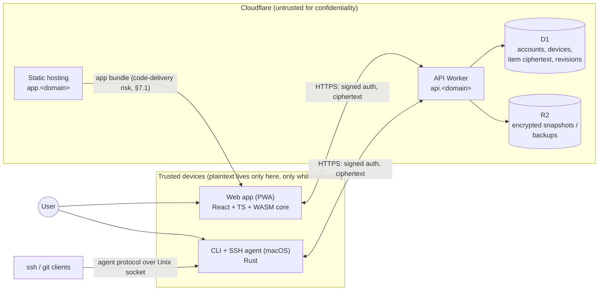
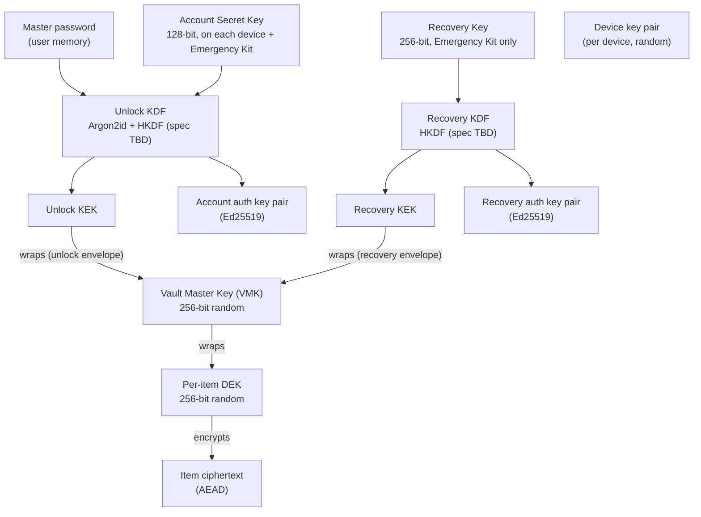

# Architecture Overview

Status: **Draft — awaiting review.** Nothing here authorizes implementing production
cryptography. Exact cryptographic constructions belong in
`docs/security/cryptographic-design.md`, which must be reviewed separately.

Requirements: [`docs/requirements/v1.md`](../requirements/v1.md).

## 1. Goals and non-goals

**Goals:** a local-first, end-to-end encrypted personal vault; the server stores
ciphertext and minimal metadata; recovery without the master password; SSH agent on
macOS; one Rust core shared by every client.

**Non-goals (V1):** multi-user sharing, enterprise features, browser extensions,
iOS native features. See `v1.md` §3.

## 2. System context



## 3. Components

| Component | Path | Language | Responsibility |
|-----------|------|----------|----------------|
| `crypto-core` | `crates/crypto-core` | Rust | KDFs, AEAD, key wrapping, envelope encode/decode, zeroization, test vectors. No I/O. |
| `vault-core` | `crates/vault-core` | Rust | Item model and validation, item encryption via `crypto-core`, TOTP, password generator, SSH key parsing, search index of the unlocked vault. |
| `sync-core` | `crates/sync-core` | Rust | Sync state machine: local change queue, pull/push, conflict detection, tombstones, schema upgrades. Storage and HTTP are injected traits. |
| `wasm-bindings` | `crates/wasm-bindings` | Rust → WASM | Narrow handle-based API for the web app (§5). |
| `cli` | `crates/cli` | Rust | `urkey` command; native storage (encrypted file cache) and HTTP for `sync-core`. |
| `ssh-agent` | `crates/ssh-agent` | Rust | Agent protocol server on a Unix socket; signs with keys from the unlocked vault. Run by launchd. |
| `web` | `apps/web` | React + TS (Vite) | UI, IndexedDB storage adapter, service worker. Calls the core only through `wasm-bindings`. |
| `api` | `cloud/workers/api` | TypeScript Worker | Auth challenges, device registry, sync endpoints, D1/R2 access. Does no vault cryptography; only verifies Ed25519 signatures. |
| `macos` | `apps/macos` | — | Reserved for the V1.1 native app (Touch ID, confirmation prompts). Empty in V1. |

Dependency direction: `crypto-core` ← `vault-core` ← `sync-core` ← {`wasm-bindings`, `cli`, `ssh-agent`}.
`crypto-core` must not depend on any other workspace crate.

## 4. Key hierarchy (conceptual)



Properties this structure gives (each needs a test):
- Password or Secret Key change → re-wrap the VMK and re-derive the auth key; items untouched.
- Recovery Key rotation → new recovery envelope + new recovery auth public key; items untouched.
- VMK rotation (after revocation/compromise) → new VMK, new DEKs, every item re-encrypted.
- Auth keys and KEKs come from the same KDF output through **separate HKDF labels**, so the
  server holding the auth *public* key learns nothing about the KEK.
- Device key pairs are random and independent of the vault keys; they only authenticate sessions.

Proposed algorithm choices (ADR candidates, final details in the crypto spec):

| Purpose | Proposal | Reason |
|---------|----------|--------|
| Password hashing | Argon2id, fixed params per envelope (start: 64 MiB, t=3, p=1) | WASM is single-threaded; iOS PWA memory limits. Benchmark before fixing. |
| Key derivation / separation | HKDF-SHA-256 with versioned labels (`urkey/v1/...`) | Standard, available in RustCrypto. |
| AEAD | XChaCha20-Poly1305 | 192-bit random nonces: no nonce coordination between devices. |
| Signatures (auth, devices) | Ed25519 | Small, fast; Workers WebCrypto can verify it. |
| RNG | OS CSPRNG (`getrandom`; `crypto.getRandomValues` in WASM) | — |
| Libraries | RustCrypto (`argon2`, `hkdf`, `chacha20poly1305`, `ed25519-dalek`), `zeroize` | Mature, audited parts, pure Rust → builds to WASM. |

## 5. WASM boundary

- JS receives **opaque handles** (e.g. an unlocked-session handle), never raw keys.
- Exposed operations are coarse: `create_account`, `unlock`, `lock`, `decrypt_item_for_display`,
  `encrypt_item`, `totp_now`, `generate_password`, sync step functions.
- Plaintext field values cross into JS only when the UI must show or copy them.
- Limitation (documented, not hidden): WASM linear memory is readable by any same-origin
  script. The boundary reduces accidental exposure; it does not stop malicious code in the page.

## 6. Data and metadata

**Stored on the server**

| Data | Where | Server can read? |
|------|-------|------------------|
| Account id, email | D1 | Yes |
| KDF salt and Argon2id params | D1 | Yes (needed before login) |
| Auth public key, recovery auth public key | D1 | Yes (public keys) |
| Unlock envelope, recovery envelope (wrapped VMK) | D1 | No (ciphertext) |
| Device records: id, public key, user-chosen name, platform, created/last-seen, revoked flag | D1 | Yes |
| Item records: random item id, revision, tombstone flag, padded size bucket, server timestamps, ciphertext | D1 | Only the metadata; content, type, title and URLs are inside the ciphertext |
| Encrypted snapshots / backups | R2 | No |

**Metadata the server can infer:** number of items, approximate sizes, when and from which
device edits happen, IP addresses (Cloudflare logs). This is accepted for V1 and listed in the
threat model.

**Local storage:** IndexedDB (web) or an app-data directory (CLI) holds the same encrypted
records plus the Secret Key. Storage of the Secret Key per platform is decision D-5.

Item and envelope schemas: [`data-model.md`](data-model.md).

## 7. Key flows

### 7.1 Code delivery (web)
The static host can serve any JavaScript. Mitigations: app and API on separate hostnames
with separate deploy credentials; strict CSP; no third-party scripts; reproducible builds with
published hashes; a service worker that pins the installed bundle and warns on change.
Residual risk is accepted for the PWA and recorded in the threat model. The CLI is the more
trusted client.

### 7.2 Account creation
```mermaid
sequenceDiagram
  participant D as Device
  participant A as API
  D->>D: generate Secret Key, VMK, Recovery Key, device key pair, salt
  D->>D: derive KEK + auth key (password, Secret Key); derive recovery KEK + recovery auth key
  D->>D: wrap VMK twice (unlock + recovery envelopes)
  D->>A: email, salt, params, auth pubkey, recovery auth pubkey, both envelopes, device pubkey
  A-->>D: account id, device id, session token
  D->>D: show Emergency Kit; require confirmation
```

### 7.3 Login / unlock on a new device (enrollment)
1. Client asks the API for salt + params for the email (the API returns deterministic fake
   values for unknown emails, so it does not reveal which emails exist).
2. Client derives the auth key from password + Secret Key and signs the server challenge.
3. Client registers a new device public key; the API creates a session bound to that device.
4. Client downloads the unlock envelope, derives the KEK, unwraps the VMK.
5. Other devices see a "new device enrolled" notice on next sync.

Returning unlock on a known device is local only (no network needed).

### 7.4 Recovery
1. Client derives the recovery auth key from the Recovery Key and signs a challenge.
2. API returns the recovery envelope; client unwraps the VMK.
3. Client **must** set a new master password and generate a new Secret Key and Recovery Key,
   then uploads new envelopes and public keys in one atomic request.
4. All other device sessions are revoked; the user re-enrolls them.

### 7.5 Revocation and VMK rotation
Revoking a device marks it revoked in D1; every later request with its session fails.
The UI then offers VMK rotation: the client generates a new VMK, re-encrypts every item with
new DEKs and re-wraps both envelopes, uploaded as one versioned "rekey" operation.

### 7.6 Sync
- Server keeps a per-account, monotonically increasing **change sequence**.
- **Pull:** `GET /sync?since=<seq>` returns changed item records and tombstones.
- **Push:** each mutation = `{mutation_id, item_id, base_revision, ciphertext | tombstone}`.
  The server applies it in a D1 transaction only if `base_revision` matches; otherwise it
  returns `409` with the current record. Repeated `mutation_id`s return the stored result.
- **Conflict:** the client keeps both versions (the server one and a "conflict copy") and asks
  the user to choose. No field-level merge in V1.
- **Staleness:** if `since` is older than tombstone retention (90 days), the client does a full
  resync. The API rejects clients below `min_client_version`.
- Full protocol: [`sync.md`](sync.md).

### 7.7 SSH agent (macOS)
`urkey agent` runs under launchd and listens on a socket the user points `SSH_AUTH_SOCK` at.
It holds no keys until `urkey unlock`; then it decrypts SSH items into locked, zeroized memory.
`urkey lock` or the idle timeout unloads them. Per-use confirmation arrives with the V1.1
native app.

## 8. Cloudflare deployment

| Piece | Product | Notes |
|-------|---------|-------|
| Web app | Workers static assets (or Pages) on `app.<domain>` | Separate deploy token from the API. |
| API | Worker on `api.<domain>` | TypeScript; routing kept minimal (see D-9). |
| Metadata + item ciphertext | D1 | Item rows are small; D1 transactions give per-account ordering. |
| Snapshots/backups | R2 | Encrypted client-side before upload. |
| Rate limiting | Workers rate limiting binding | On auth and recovery endpoints. |

No Durable Objects in V1: for a single user, D1 transactions are enough to serialize revisions.

## 9. Repository layout

```text
apps/web/                 React + TS PWA
apps/macos/               reserved (V1.1)
crates/crypto-core/       crates/vault-core/   crates/sync-core/
crates/wasm-bindings/     crates/cli/          crates/ssh-agent/
cloud/workers/api/        Worker + D1 migrations
docs/{requirements,architecture,security,decisions,ux}/
tests/fixtures/           generated test vectors (never real secrets)
tests/integration/        cross-component tests (CLI ↔ Worker ↔ WASM)
Cargo.toml                Rust workspace
pnpm-workspace.yaml       JS workspace (apps/web, cloud/workers/*)
rust-toolchain.toml       pinned toolchain + wasm32 target
```

## 10. Testing strategy

| Level | Tools | Covers |
|-------|-------|--------|
| Unit (Rust) | `cargo test`, `proptest` | Crypto round-trips, envelope parsing, TOTP vectors, sync state machine. |
| Fuzz | `cargo fuzz` | Envelope and item decoders, SSH agent message parser. |
| Interop | Shared JSON vectors in `tests/fixtures` | Native Rust ↔ WASM produce identical outputs. |
| Worker | Vitest + `@cloudflare/vitest-pool-workers` | API, D1 migrations, idempotency, conflicts. |
| Web | Vitest + Testing Library; Playwright | Components, a11y (axe), full flows. |
| End-to-end | Playwright + CLI against local `wrangler dev` | Two devices sync, recovery, revocation. |

## 11. Decisions

D-1 to D-12 were accepted by the owner on 2026-11-26 ("use your recommendations").
Accepted decisions still need their ADR files written; D-13 onward are proposals.

| ID | Decision | Choice | Status | ADR |
|----|----------|--------|--------|-----|
| D-1 | PWA code-delivery risk | Accept, mitigate (§7.1), document | Accepted | 0002 |
| D-2 | Account authentication | Ed25519 key derived from password + Secret Key (challenge/response). OPAQUE was considered; the 128-bit Secret Key already defeats offline guessing from a server dump, and this is simpler. | Accepted | 0003 |
| D-3 | AEAD | XChaCha20-Poly1305 | Accepted | 0004 |
| D-4 | VMK rotation in V1 | Yes | Accepted | 0005 |
| D-5 | Secret Key storage on device | Web: wrapped by a non-extractable WebCrypto key in IndexedDB. macOS: Keychain. | Accepted | 0006 |
| D-6 | macOS V1 scope | Rust CLI + launchd agent; native app in V1.1 | Accepted | 0007 |
| D-7 | RSA signing in SSH agent | Not in V1 | Accepted | 0008 |
| D-8 | Item ciphertext location | D1 rows (padded); R2 for snapshots only | Accepted | 0009 |
| D-9 | Worker routing | Hand-written router; revisit (e.g. Hono) only if routes grow | Accepted | 0010 |
| D-10 | Argon2id params | 64 MiB / t=3 / p=1, floor 32 MiB / t=2; confirm with iPhone PWA benchmark | Accepted, benchmark pending | crypto spec |
| D-11 | Optional recovery delay (threat model T-12) | Not in V1; reconsider for V1.1 | Accepted | crypto spec |
| D-12 | New Recovery Key on every VMK rotation | Yes (the unlocked client does not hold the RK) | Accepted | crypto spec |
| D-13 | CLI local store | SQLite via `rusqlite` (bundled); contents are ciphertext only | Proposed | 0011 |
| D-14 | When clients sync | Only while unlocked in V1 (pulled records are verified immediately) | Proposed | sync.md |
| D-15 | Server write serialization | Conditional write + sequence bump in one D1 batch; fall back to one Durable Object per account if concurrency tests fail | Proposed | sync.md |

ADR 0001 records the overall technology stack from the brief.
