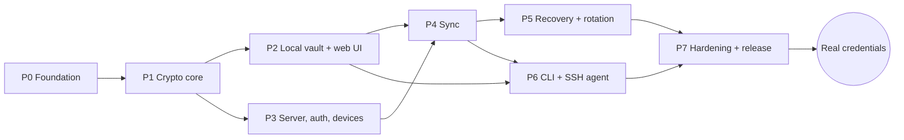

# Roadmap (v1)

Status: **Draft — awaiting review.**
Every phase ends with a **gate**: its acceptance criteria pass in CI (or are recorded as a manual
check), docs are updated, and the owner signs off. A phase does not start before the previous
gate unless noted. Requirement ids refer to [`requirements/v1.md`](requirements/v1.md).

P2 and P3 can run in parallel after P1. P6 can start its parsing/agent work after P2 and needs
P4 only for CLI sync.

## P0 — Foundation

**Status: complete (2026-11-26).**

**Deliverables**
- Remaining docs: `security/recovery.md`, `security/devices.md`.
- ADR files 0001–0013 (decision index in `decisions/README.md`).
- Scaffolding with no cryptography: Cargo workspace with empty crates, `rust-toolchain.toml`,
  pnpm workspace, `apps/web` (Vite + React + TS strict, tokens file, empty shell), `cloud/workers/api`
  (Worker with `/v1/health`, D1 migration folder, Workers Vitest integration; managed with the `cf` CLI), `deny.toml`, lint configs.
- CI (GitHub Actions): `cargo fmt --check`, `clippy -D warnings`, `cargo test`, `cargo deny check`,
  WASM build, `pnpm lint/typecheck/test/build`.

**Acceptance**
- Every command in `CLAUDE.md` runs and passes on the skeleton, locally and in CI.
- `cargo deny check` passes with the licence allow-list in `deny.toml`.
- Owner approves `cryptographic-design.md` for implementation (moves `CLAUDE.md` out of the
  design phase). **Done** (2026-11-26).
- CI green on GitHub. **Done** — all four jobs passed on GitHub Actions (runs 1 and 2,
  2026-11-26).

## P1 — Crypto core (current)

**Deliverables:** `crypto-core` implementing crypto design §3–§10: encodings, KDFs, containers,
AEAD, signatures message builders, zeroizing secret types, uniform errors; test vectors in
`tests/fixtures/crypto-v1/`; an independent Python reproduction of the vectors; fuzz targets;
Argon2id benchmark in WASM.

**Acceptance**
- All vector sets in crypto §12 pass natively and in WASM (under Node).
- The independent Python script reproduces every vector byte-for-byte.
- Fuzz targets for container and encoding parsers run 10 min each in CI-nightly with no crashes.
- Negative tests: tampered header/AAD/tag/truncation → `DecryptError`; params below floor rejected.
- No secret type implements `Debug`/`Display` (compile-time test); `#![forbid(unsafe_code)]`.
- Benchmark recorded: unlock time on an iPhone PWA and a mid-range laptop; D-10 confirmed or
  adjusted in the crypto spec.
- Review gate part 1: owner (and ideally an external reviewer) reviews the P1 diff against §13.

**Status (2026-11-26)**

| Criterion | State |
|-----------|-------|
| Vectors native + WASM | Done: 6 sets; Rust native and wasm32/Node tests pass |
| Independent Python reproduction | Done: 102/102 checks (same author as the Rust code, see fixtures README) |
| Fuzzing | Targets done, 60 s each locally with no findings; the 10-min nightly job is set up but has not run yet |
| Negative tests | Done: every byte flip, truncation, extension, wrong revision, weak params |
| Secret types | Redacting `Debug` (as `CLAUDE.md` allows), no `Display`/`Clone`, tested; `#![forbid(unsafe_code)]`. The wording "no `Debug`" above is stricter than `CLAUDE.md` — owner to confirm |
| Benchmark | Native 153 ms, WASM/Node 228–319 ms. **iPhone PWA: open** (needs a real device) |
| Review gate part 1 | **Open:** owner review of the P1 diff |

## P2 — Local vault and web UI (no server)

**Deliverables:** `vault-core` (item model, validation, unknown-field preservation, TOTP,
generator, SSH key parsing), `wasm-bindings` (worker-hosted, handle-based API), web app with the
design system and all vault screens; local-only account (stored in IndexedDB) for development.

**Acceptance**
- R-ACC-3/4/5, R-ITEM-1…6, R-UX-1…4 pass.
- RFC 6238 vectors; generator uniformity test (χ² on 10⁶ samples).
- Storage inspection test: no plaintext in IndexedDB after creating each item type (R-ITEM-2).
- Canary test: known secrets never appear in console output, DOM attributes, URLs or titles (R-SEC-1).
- UX acceptance in `ux/screens.md` §8 (axe, layouts, keyboard run-through).

## P3 — Server, authentication and devices

**Deliverables:** Worker API (prelogin, challenge, create, login, refresh, step-up, account,
devices), D1 migrations (data-model §3), rate limiting, scheduled cleanup; web create-account and
sign-in flows; Emergency Kit.

**Acceptance**
- R-ACC-1/2, R-AUTH-1…3, R-DEV-1/2 pass.
- Request-capture test: no `PW`, `ASK`, `RK`, `VMK`, DEK or plaintext in any request (invariant 1).
- Unknown-email prelogin indistinguishable in shape and timing (± 20 ms median).
- Revoked device: next request → 401; refresh fails.
- Worker verifies the signatures in `signatures.json` fixtures.

## P4 — Sync

**Deliverables:** `sync-core` (outbox, pull/push, conflicts, integrity checks, resync), Worker
sync endpoints with idempotency, web integration, Needs-attention UI.

**Acceptance**
- R-SYNC-1…6 pass.
- Simulation suite (sync.md §11.1): ≥ 10,000 random scenarios with 3 devices, all properties hold.
- Worker concurrency test proves D-15 (parallel pushes never break the feed invariant); otherwise
  the Durable Object fallback is implemented and an ADR records it.
- Integrity tests: swapped, rolled-back and forged records are quarantined (T-4, T-6, T-9).
- Two-browser Playwright test: offline edits on both, reconnect, resolve conflict.

## P5 — Recovery and key rotation

**Deliverables:** recovery flow, master password change, Secret Key rotation, Recovery Key
rotation, VMK rotation, device-removal-then-rotate flow, security events and notices.

**Acceptance**
- R-REC-1…4, R-ACC-6/7, R-DEV-3 pass.
- Item containers byte-identical after password/Secret Key change (invariant 3).
- After VMK rotation no container references the old `vmk_id` (invariant 4); a revoked device's
  old VMK cannot open new items.
- Old Recovery Key fails after rotation and after recovery; no moment where neither works
  (fault-injection test killing the request mid-way).
- Other devices handle each event as in sync.md §8.2.

## P6 — CLI and SSH agent (macOS)

**Deliverables:** `urk` CLI (R-SSH-4 commands), SQLite cache, Keychain storage, `ssh-agent`
daemon with launchd plist and setup command, CLI sync.

**Acceptance**
- R-SSH-1…4 pass; agent-protocol crate chosen by ADR.
- `ssh -T` against a local test `sshd` using `SSH_AUTH_SOCK` works for Ed25519 and ECDSA keys;
  works with `git` over SSH.
- After `urk lock` / idle timeout, `ssh-add -l` lists no identities and signing fails.
- Socket permissions 0600 in a 0700 directory; peer-uid check rejects another user (T-18).
- CLI and web interoperate on the same account (create on web, sign on CLI, and vice versa).

## P7 — Hardening and release

**Deliverables:** strict CSP and security headers, separate app/API hosts and deploy tokens,
reproducible web build with published hashes, service-worker bundle pinning, encrypted export
and R2 snapshots, deployment to Cloudflare with `cf deploy` (needs `CLOUDFLARE_API_TOKEN` — requested at this
point), threat-model and docs refresh, external review.

**Acceptance**
- R-SEC-1…5 and R-SEC-10…13 pass.
- Two clean builds produce identical bundle hashes; About screen shows the hash.
- Security review against crypto §13 and threat model §6 done; findings fixed or accepted in writing.
- Restore from an encrypted export into a fresh account works.
- **M1 — controlled personal testing:** deployed, used daily with **test data only** for two weeks
  on two devices plus the CLI, with no data loss.

## M2 — Real credentials

Allowed only when: P7 gate passed, the review findings are closed, the brief's definition of
done (§11) holds, and the owner explicitly approves.

## After v1 (candidates)
Native macOS app (Touch ID unlock, per-use SSH confirmation — R-SSH-5), enrollment approval from
an existing device (R-DEV-4), recovery delay (D-11), attachments and more item types, RSA signing
(D-7), iOS features, browser extension.
