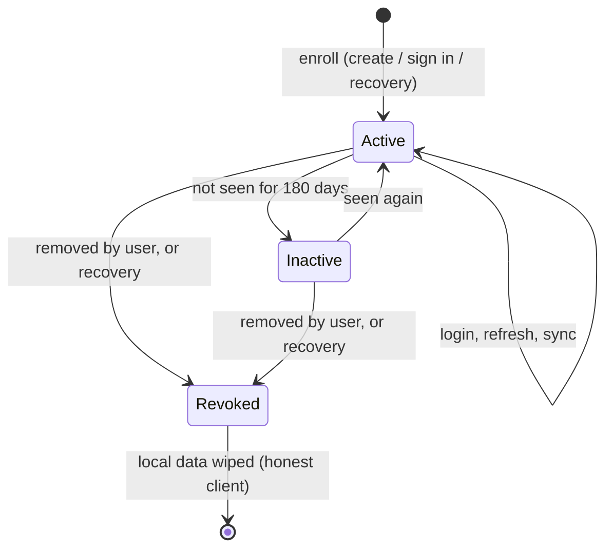

# Device Lifecycle

Status: **Draft — awaiting review.**
Related: [`cryptographic-design.md`](cryptographic-design.md) §7.4, §7.9, §8,
[`recovery.md`](recovery.md), [`../architecture/sync.md`](../architecture/sync.md) §8,
[`../architecture/data-model.md`](../architecture/data-model.md) §3 (`devices`, `sessions`).
Requirements: R-AUTH-3, R-DEV-1…4.

## 1. What a device is

A device is one client installation: one browser profile with the PWA, or one macOS user
account running the CLI/agent. Each has:

| Item | Where | Purpose |
|------|-------|---------|
| `device_id` | random 16 B, server + device | Identity in the device list and sessions |
| Device key pair (Ed25519) | private: non-extractable WebCrypto key / Keychain; public: server | Proves the device on login and session refresh |
| Secret Key copy | wrapped locally (crypto §8) | Lets the user unlock with only the password |
| Encrypted vault cache | IndexedDB / SQLite | Offline access |
| Name, platform, client version | server (visible metadata) | Shown in the device list |

Two browser profiles on the same computer are two devices. Clearing site data removes the
device's local state; it then shows as inactive until removed.

## 2. States

`Inactive` is only a label for the list; the device keeps working if it returns. `Revoked` is
final: re-adding means enrolling again with a new device key.

## 3. Enrollment

Three ways, all producing a new device key pair and a `device_enrolled` security event:

| Path | Needs | Notes |
|------|-------|-------|
| Account creation | — | First device |
| Sign in (crypto §7.4) | Email + Secret Key + master password | Typical new-device path; V1 |
| Recovery (recovery.md §3) | Email + Recovery Key | Revokes all other devices |
| Approval from an existing device (QR) | An unlocked enrolled device | Later (R-DEV-4) |

After enrollment, every other device shows: **"New device added: <name> (<platform>), <time>.
Not you? Remove it and change your password and vault key."** The notice stays until dismissed.
Email notification is off by default (A11).

Limits: 20 active devices per account; enrollment is rate-limited per account and IP.

## 4. Removal (revocation)

1. User opens Settings › Devices, chooses a device, **Remove device**.
2. Confirm dialog explains: "It will be signed out and can't sync. Anything it already has stays
   on it. To protect future changes, also change your vault key."
3. Step-up signature; server sets `revoked_at`, deletes its sessions, records `device_revoked`.
4. The app offers **Change vault key now** (recovery.md §4.4), preselected when the reason chosen
   is "Lost or stolen".

Effects:
- Every request with that device's session returns `401 device_revoked` immediately; refresh
  signatures are rejected (R-DEV-1).
- An honest client wipes its local state after offering an export of unsynced changes
  (sync.md §8.3).
- A dishonest or offline client keeps whatever it already had — hence VMK rotation (T-14).

A device cannot remove itself through this path; to leave, use **Sign out and remove data from
this device**, which revokes it and wipes local state in one step.

## 5. Sessions

- Short-lived bearer tokens bound to one device (crypto §7.9): idle 1 h, absolute 24 h.
- Refresh needs only the device key, so an unlocked device keeps syncing without asking for the
  password again.
- Server stores only the token hash. Sessions are deleted on revoke, recovery and expiry.
- Recovery sessions (`scope = recovery`) can only fetch the recovery envelope and submit the
  recovery transaction.

## 6. Device list (Settings › Devices)

| Column | Source |
|--------|--------|
| Name (editable) | `devices.name` |
| Platform | `devices.platform` |
| Added | `created_at` + `enrolled_via` ("signed in", "recovered") |
| Last active | `last_seen_at` (updated at most every 5 min to limit writes) |
| Badges | This device · Inactive (> 180 days) |

## 7. Local storage by platform

| | Web (PWA) | macOS CLI / agent |
|--|-----------|-------------------|
| Device private key | Non-extractable Ed25519 `CryptoKey` in IndexedDB | Keychain, this-device-only |
| Secret Key | Wrapped by a non-extractable AES-GCM key in IndexedDB | Keychain, this-device-only |
| Vault cache | IndexedDB (ciphertext) | SQLite file, 0600 in a 0700 directory |
| Protection when locked | Master password (browser profile is not hardware-protected) | Master password + macOS login keychain |

## 8. Tests (acceptance)
- R-AUTH-3: a token used with another device's id is rejected.
- R-DEV-1: list shows all devices; removal → next request 401; refresh fails; sessions deleted.
- R-DEV-2: enrollment produces a notice on every other device at next sync.
- Removal requires step-up: a session token alone cannot revoke a device.
- "Sign out and remove data" leaves no urkey data in IndexedDB / the app directory / Keychain.
