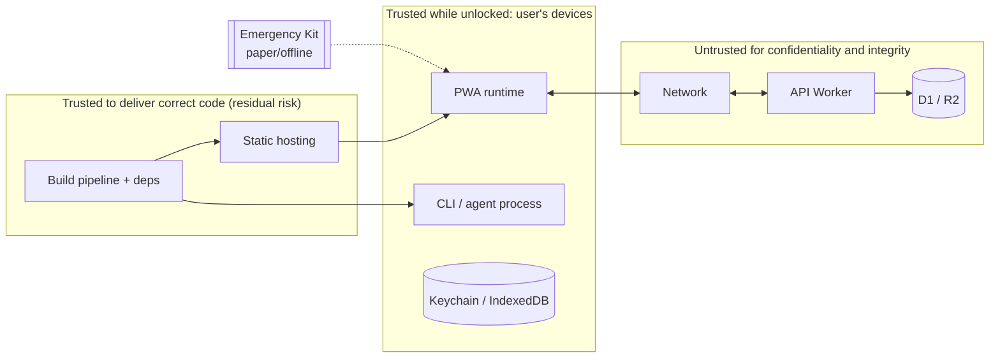

# Threat Model (v1)

Status: **Draft — awaiting review.**
Related: [`cryptographic-design.md`](cryptographic-design.md), [`../architecture/overview.md`](../architecture/overview.md), [`../requirements/v1.md`](../requirements/v1.md).

## 1. Scope

The system covered: the web app (PWA), the Rust CLI and SSH agent on macOS, the Cloudflare
API Worker with D1 and R2, the static hosting for the web app, the build and deploy pipeline,
and the user's Emergency Kit. It is a single-user product; there are no other users of the
same vault.

## 2. Assets

| ID | Asset | Why it matters |
|----|-------|----------------|
| AS-1 | Decrypted vault content (passwords, notes, TOTP secrets, SSH private keys) | The thing being protected |
| AS-2 | VMK and item DEKs | Decrypt AS-1 |
| AS-3 | Master password | With AS-4, unlocks everything |
| AS-4 | Account Secret Key (ASK) | With AS-3, unlocks everything; stored on devices |
| AS-5 | Recovery Key (RK) | **Alone** unlocks everything |
| AS-6 | Account auth key, recovery auth key, device keys, session tokens | Server access: download ciphertext, change envelopes, revoke devices |
| AS-7 | Metadata: email, item count/sizes, timing, devices, IP addresses | Privacy |
| AS-8 | Availability and integrity of the vault | Losing or silently corrupting data is a failure too |
| AS-9 | The app code delivered to the browser | Whoever controls it can capture AS-3 |

## 3. Trust boundaries

- **T1** — plaintext exists only here, only while unlocked.
- **T2** — may read, modify, delete, replay or withhold anything it stores or transmits.
  It must not be able to read AS-1..AS-5 or forge changes that clients accept.
- **T3** — the code we run. Compromise here defeats end-to-end encryption on the web; it is
  reduced, not eliminated (T-3).

## 4. Assumptions

1. The OS, browser and hardware of an **unlocked** device are not compromised.
2. The OS CSPRNG works.
3. Argon2id, HKDF-SHA-256, XChaCha20-Poly1305 and Ed25519, and their RustCrypto/WebCrypto
   implementations, are secure as used.
4. TLS to Cloudflare is not broken (but we do not rely on it for confidentiality of vault data).
5. The user keeps the Emergency Kit offline and private.
6. The user's master password has reasonable strength (warning shown otherwise).
7. Cloudflare as a platform may be compelled, breached or misconfigured; we design as if the
   server side is hostile (T2).

## 5. Adversaries

| ID | Adversary | Capability |
|----|-----------|------------|
| AD-1 | Network attacker | Observe/modify traffic (TLS assumed, but defence in depth) |
| AD-2 | Database thief | Full copy of D1 and R2 (breach, leaked backup) |
| AD-3 | Malicious or compromised server | Everything AD-2 can, plus change API responses live, replay, withhold, delete |
| AD-4 | Malicious code delivery | Ship modified web app JS (hosting/CI/Cloudflare account takeover) |
| AD-5 | Supply-chain attacker | Malicious npm/crates dependency or build tool |
| AD-6 | Thief of a locked device | Disk and browser-profile access, no password |
| AD-7 | Malware / attacker on an unlocked device | Reads memory, screen, clipboard, keystrokes |
| AD-8 | Revoked (formerly trusted) device | Holds old cache, ASK and possibly the VMK |
| AD-9 | Phisher | Lookalike site or fake prompts |
| AD-10 | Other local user/process on macOS | Tries the SSH agent socket or the cache files |
| AD-11 | Emergency Kit thief | Has ASK and RK |
| AD-12 | Online guesser | Calls auth endpoints at scale |

## 6. Threats and mitigations

Status: **M** = mitigated by design, **P** = partly mitigated, **A** = accepted residual risk.

| ID | Threat | Adversary | Mitigation | Status |
|----|--------|-----------|------------|--------|
| T-1 | Read vault from a stolen database | AD-2 | Only ciphertext stored; keys wrapped by KEKs derived from password **and** 128-bit ASK; server holds only public auth keys | M |
| T-2 | Offline password guessing from stolen database | AD-2 | Needs ASK (2^128) as well; Argon2id on top | M |
| T-3 | Modified web app captures password/ASK/plaintext | AD-4 | Separate app and API hosts and deploy credentials; strict CSP; no third-party scripts; reproducible builds with published hashes; service worker pins the bundle and warns on change; CLI as the more-trusted client | **A/P** — cannot be fully solved for a web app |
| T-4 | Server swaps ciphertext between items or presents old payload as new | AD-3 | AAD binds `account_id`, `item_id`, `revision` | M |
| T-5 | Server tampers with KDF params (downgrade) or envelopes | AD-3 | Params and salt in envelope AAD; client-side floor/ceiling on params | M |
| T-6 | Server forges a deletion | AD-3 | Tombstones are authenticated with the item DEK | M |
| T-7 | Server deletes data or refuses service | AD-3 | Local offline cache on every device; encrypted export | P (availability not guaranteed) |
| T-8 | Server injects a fake item | AD-3 | Server lacks the VMK, so it cannot produce a valid DEK wrap; fails to decrypt | M |
| T-9 | Server rolls back the vault or hides recent changes (fork) | AD-3 | Per-item revision in AAD; clients remember the highest revision and `vault_seq` seen and alert on decrease | P — a client that has never seen the newer state cannot detect withholding |
| T-10 | Stolen session token used to change keys or revoke devices | AD-1/AD-7 | Step-up signatures by `auth_sk` for sensitive operations; short-lived tokens; hashed at rest | M |
| T-11 | Locked stolen device: brute-force the cached envelope | AD-6 | Attacker has ASK from the device, so security = Argon2id cost × password strength; strength warning; user revokes device and rotates | P |
| T-12 | Emergency Kit stolen | AD-11 | RK alone recovers the vault. Recovery triggers a notice on all devices and revokes them, so the owner notices; rotation replaces RK. Optional recovery delay (Q-3) would stop online abuse but not an attacker who also has a database copy | **A/P** |
| T-13 | Malware on an unlocked device | AD-7 | Out of scope to prevent; reduce exposure: auto-lock, masked fields, clipboard clearing (native), SSH keys unloaded on lock | A |
| T-14 | Revoked device keeps reading the vault | AD-8 | Revocation blocks sync; **VMK rotation** makes later items unreadable to it. Data it already had stays exposed | P |
| T-15 | Malicious dependency | AD-5 | Minimal deps; lockfiles; `cargo deny`, `pnpm audit`; review new deps in an ADR; pinned toolchain | P |
| T-16 | Phishing site collects password | AD-9 | Installed PWA on a fixed origin; ASK is stored on enrolled devices so users rarely type it — a request to type it is a warning sign (UX copy says so); login signatures bind `api_origin` | P |
| T-17 | Online guessing / account enumeration | AD-12 | Login needs a signature from `auth_sk` (needs ASK); fake prelogin responses; rate limiting on auth and recovery endpoints | M |
| T-18 | Other local user uses the SSH agent | AD-10 | Socket in a 0700 directory, mode 0600, peer-uid check; keys only while unlocked | M |
| T-19 | SSH agent forwarding abused by a remote host | AD-3-like remote | Documentation: do not forward the agent to untrusted hosts; per-use confirmation in v1.1 | A (v1) |
| T-20 | Secrets leak through logs, errors, URLs, crash reports | all | No secrets in logs (redacting `Debug`), uniform errors, no analytics, canary-secret test in CI | M |
| T-21 | Clipboard read by other apps or kept in history | AD-7 | Explicit copy only; native clears after 90 s; PWA cannot clear (UI says so) | P |
| T-22 | Old password still unlocks a device that has not synced since a password change | AD-6 | Documented; other devices update on next sync; to cut off a lost device, revoke + rotate | A |
| T-23 | Weak randomness | — | OS CSPRNG only; fail closed; test-only deterministic RNG blocked in release | M |
| T-24 | Bugs in our composition (wrong AAD, label reuse, nonce reuse) | — | Spec review gate, test vectors with an independent implementation, fuzzing, no `unsafe` in core | P (needs review) |
| T-25 | XSS in the web app reads unlocked secrets | AD-4-like | React escaping, no `dangerouslySetInnerHTML` with item data, strict CSP, Trusted Types where supported; item URLs rendered as text and opened with `noopener` | P |
| T-26 | Cross-site requests against the API | AD-9 | Bearer tokens (no cookies), CORS allows only the app origin | M |
| T-27 | Stolen encrypted export file | AD-2-like | The file holds only what D1 already stores (unlock envelope + records, ADR 0017); opening it needs the password **and** ASK of the time it was made | M |
| T-28 | Records silently removed from an export file | AD-2-like | Changed, swapped or replayed records fail authentication; whole-record removal is not detected (same as deleting the file) | A |

## 7. Metadata visible to the server (AS-7)

Visible by design: email, `account_id`, KDF salt and params, auth/recovery public keys,
device list (name, platform, first/last seen, revoked), item ids, revisions, padded sizes,
tombstone flags, timing of every request, IP addresses and user agents (Cloudflare logs),
snapshot sizes and times.

Not visible: item types, titles, usernames, URLs, notes, passwords, TOTP secrets, SSH keys,
item count per type, folder/tag structure, search terms.

Accepted for v1. Possible later reductions: device names encrypted under the VMK, coarser
size buckets.

## 8. Security invariants

These must always hold; each has (or will have) a test.

1. No request body sent to the API contains `PW`, `ASK`, `RK`, `VMK`, a DEK or item plaintext
   (request-capture test with canary values).
2. Every stored or transmitted encrypted object parses as a §6.1 container of the expected kind.
3. Changing the password or ASK leaves every item container byte-identical.
4. After VMK rotation, no container references the old `vmk_id`.
5. After lock, no unlocked-session handle works and the agent holds no keys.
6. A revoked device's tokens and refresh signatures are rejected.
7. Decrypt failures are indistinguishable to the caller.
8. Release builds contain no `test-vectors` feature.

## 9. Out of scope

- Fully compromised endpoints (AD-7) beyond the reductions in T-13.
- Physical side channels, cold-boot attacks on RAM.
- Coercion of the user.
- Cloudflare's own infrastructure security beyond treating it as untrusted (T2).
- Traffic analysis beyond §7.
- Features outside v1 scope (sharing, browser autofill, iOS).

## 9a. Implementation status (2026-11-26, before the independent review)

- **T-3 / T-25:** the app is served by its own assets-only Worker. Its `_headers` file sets
  `default-src 'none'`, `script-src 'self' 'wasm-unsafe-eval'`, `style-src 'self'`, a
  `connect-src` limited to the API origin, `frame-ancestors 'none'`, and
  `require-trusted-types-for 'script'` with a single `urkey` policy. Playwright runs the
  production build and fails on any CSP or Trusted Types violation. Radix's scroll lock injected
  `<style>` elements, so it was replaced by a CSSOM-only shim instead of weakening `style-src`.
- **T-3:** the release hash (SHA-256 over the served files) is reproducible, which CI checks.
  It is shown in Settings › About and published in `release.json`. The service worker pins the
  cached release; a new release waits for the user's approval in a banner. The hash is only
  compared when the user does it: nothing checks it against an independent source yet.
- **T-20:** the tests check that storage (IndexedDB, the export file) contains no plaintext,
  and that error messages are fixed strings. A full canary test over console output, DOM
  attributes and URLs is part of the review checklist.
- **T-21:** the CLI prints a field only on request (`--field`). `urk item copy` puts it on the
  clipboard and a detached helper clears it after 90 s if it is unchanged (R-ITEM-7). The helper
  gets the value on stdin, not as an argument, so `ps` never shows it.

## 10. Residual risks for the owner to accept

1. **T-3** — the web app is only as trustworthy as its delivery path.
2. **T-12** — anyone holding the Recovery Key can take over the vault.
3. **T-9** — the server can hide recent changes from a device that never saw them.
4. **T-14** — data already on a revoked device stays exposed.
5. **T-11 / T-22** — a stolen device's protection rests on the master password.
6. **T-28** — an export file can lose whole records without detection.

## 11. Review triggers

Revisit this document when: a new client type or platform is added, a new item type stores a
new kind of secret, the server gains any decrypt capability, sharing is introduced, or a
dependency in the crypto path changes.
