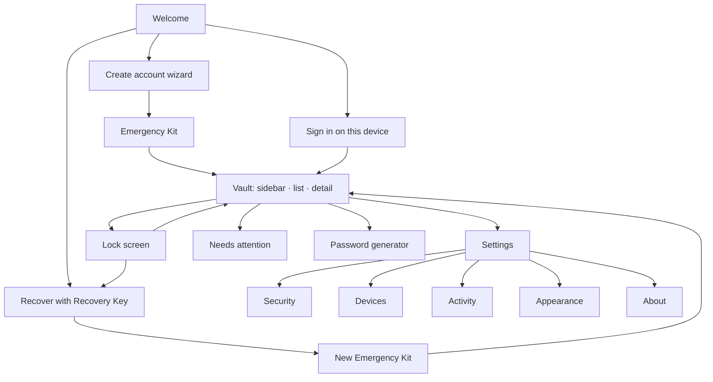

# Screens, Flows and Components (v1)

Status: **Draft — awaiting review.**
Related: [`design-principles.md`](design-principles.md), [`../requirements/v1.md`](../requirements/v1.md),
[`../architecture/sync.md`](../architecture/sync.md) §10 (sync states).

## 1. Screen map



Routing: hash-free client routes with opaque local ids (`/items/:localId`) — never titles.
When locked, every route renders the lock screen; the intended route is restored after unlock.

## 2. Layout

### 2.1 Desktop (≥ 1200 px) — three panes

```text
┌──────────────┬────────────────────────┬──────────────────────────────────────┐
│ urkey     🔒 │ 🔍 Search vault   (/)  │  [tile] GitHub                ★  ⋯   │
│              │ Sort: Title ▾   + New  │  Login · edited 2 days ago           │
│ All items    │────────────────────────│ ──────────────────────────────────── │
│ Favorites    │ [G] GitHub             │  username   alice            [Copy]  │
│              │     alice              │  password   ••••••••   [Reveal][Copy]│
│ Logins       │ [n] Home Wi-Fi         │  one-time   123 456  ◔ 18s   [Copy]  │
│ Secure Notes │     Router password…   │  website    github.com       [Open]  │
│ SSH Keys     │ [>] work-laptop        │ ──────────────────────────────────── │
│              │     ed25519 · SHA256:… │  notes                               │
│ TAGS         │                        │  …                                   │
│  work        │                        │                                      │
│              │                        │                       [Edit]         │
│ ⚠ Needs      │                        │                                      │
│   attention 1│                        │                                      │
│──────────────│                        │                                      │
│ ● Synced     │                        │                                      │
│ ⚙ Settings   │                        │                                      │
└──────────────┴────────────────────────┴──────────────────────────────────────┘
```
Sidebar 240 px, list 320–400 px (resizable), detail fills the rest (max content width 720 px).

### 2.2 Tablet (768–1199 px)
Sidebar collapses to a 64 px icon rail (labels in tooltips; a button expands it as an overlay);
list + detail remain side by side.

### 2.3 Phone (< 768 px)
One pane at a time with a back button: categories → list → detail. Search is pinned at the top
of the list; **+ New** is a floating button. Copy buttons stay at least 44 × 44 px.

## 3. Screens

Each screen lists its states; every state must exist in the UI and in tests (R-UX-3).

### 3.1 Welcome
"Create a new vault" (primary), "Sign in on this device", "Use a Recovery Key". One sentence on
what urkey is and that nothing readable leaves the device.

### 3.2 Create account wizard (R-ACC-1, R-ACC-2)
1. **Email** — what it is used for (sign-in only, no marketing).
2. **Master password** — field + strength meter (estimate, local only), confirm field. Warns
   below the policy (crypto §3.1); explains "we can't reset it for you; your Recovery Key can".
3. **Creating your keys** — progress (Argon2id ~1–2 s).
4. **Emergency Kit** (D-18) — shows sign-in address, email, **Secret Key** and **Recovery Key**
   with a short explanation of each. Actions: **Print** (print-only page, rendered locally) and
   **Download as text**. To continue, the user types the last 4 characters of the Recovery Key
   (proves they saved it). Copy is offered only for the Secret Key.
5. **Done** — short tour (3 hints: search, copy, lock).

States: network error on submit (retry; nothing created until the server confirms), email already
used.

### 3.3 Sign in on this device (enrollment, crypto §7.4)
Email → Secret Key (format-aware input: accepts with or without dashes, validates the check
character live) → master password → device name (prefilled "Chrome on macOS") → vault.
States: wrong combination (one generic message), rate limited, offline ("You need a connection to
add this device").

### 3.4 Lock screen (R-ACC-3, R-ACC-4)
Email shown, master password field, **Unlock**, link "Forgot your password? Use your Recovery Key".
Shows sync state (e.g. "Offline — your saved vault is available"). Unlock progress text.
States: wrong password (generic), "Your password was changed on another device — use the new
one", "Enter your new Secret Key" (after rotation elsewhere), revoked device (sync.md §8.3).

### 3.5 Recovery (R-REC-1, R-REC-2)
1. Email + Recovery Key.
2. Warning: "This signs out all your other devices and replaces your Secret Key and Recovery Key."
3. New master password (+ confirm).
4. New Emergency Kit (same confirmation as 3.2).
5. Offer: "Also change your vault key?" (recommended if you think someone else had access).
States: invalid key (generic), offline, rate limited.

### 3.6 Vault — sidebar
Sections: All items, Favorites, Logins, Secure Notes, SSH Keys, Tags (collapsible), Needs
attention (only when > 0, with count). Footer: sync indicator (§4) and Settings. Header: app name
and **Lock** button.

### 3.7 Vault — item list (R-ITEM-3)
- Search filters as you type across title, username, URLs, tags (in-memory, local).
- Sort: Title (A–Z, with letter group headers) or Recently edited.
- Row: type tile, title, subtitle (design-principles §3.3), unsynced dot, conflict badge.
- Empty states: new vault ("Add your first login" + "Import an SSH key"), empty category
  ("No secure notes yet — + New note"), no search results ("No items match 'xyz'").

### 3.8 Vault — item detail (R-ITEM-4, R-ITEM-5)
- Header: tile, title, favourite star, overflow menu (Duplicate, Delete).
- Field rows: label, value, inline actions (Copy; Reveal for concealed; Open for URLs).
  Clicking a value copies it (same as the Copy button).
- TOTP row: current code grouped `123 456`, countdown ring, copy; turns amber in the last 5 s.
- SSH key: public key (Copy), fingerprint, key type, "Available to SSH agent" toggle, private
  key concealed with Reveal behind a confirmation ("Only reveal this if you need to copy it
  somewhere safe").
- Footer: created/edited times, "Edited on <device name>", password history (collapsed).
- States: unsynced, in conflict (banner linking to resolution), unsupported schema (read-only
  banner), damaged.

### 3.9 Create / edit item
- **+ New** opens a type menu: Login, Secure Note, SSH Key.
- Same layout as detail, fields become inputs; **Save** (Ctrl/⌘+Enter), **Cancel** (Esc, confirms
  if there are changes).
- Login password field has a generator button (opens §3.11 inline) and a strength hint.
- "Add one-time password": paste `otpauth://` URI, enter secret manually, or scan a QR image
  (decoded locally).
- "Add field" for custom fields (text, concealed, URL, email).
- Validation inline (data-model §1.7).

### 3.10 SSH key import (R-SSH-1)
Paste or drop a private key file → if encrypted, passphrase prompt → preview: type, fingerprint,
comment → title (prefilled from comment) → Save. Unsupported types are explained ("RSA keys can
be stored but not used by the SSH agent yet").

### 3.11 Password generator (R-ITEM-6)
Popover (from a password field) or standalone page. Tabs: **Random** (length slider 8–64,
toggles: digits, symbols, avoid look-alike characters) and **Passphrase** (words 4–10, separator,
capitalize). Live preview in mono, **Regenerate**, **Copy**, **Use** (when opened from a field).
Shows an estimated strength in bits.

### 3.12 Needs attention (sync.md §6–§7)
List of conflicts, failed changes and integrity problems. Conflict view: two columns ("This
device" / "Other device", changed fields highlighted, concealed values masked with per-field
reveal), actions **Keep this device's**, **Keep other**, **Keep both**.

### 3.13 Settings
- **Security**: auto-lock (1, 5, 10, 30 min, 1 h; lock on sleep/hide toggle where supported),
  Change master password, Change Secret Key, Replace Recovery Key, Change vault key (each opens
  a dialog that explains impact first, then asks for the master password).
- **Devices** (R-DEV-1): list with name, platform, added, last active, "This device" badge,
  inactive badge (> 180 days); **Remove device** → confirm → offer "Also change your vault key"
  (R-DEV-3).
- **Activity**: security events (device added, password changed, recovery used, …).
- **Appearance**: theme (system / light / dark), density (comfortable / compact).
- **About**: version, build hash (to compare with published release hashes, R-SEC-11), licences.

## 4. Global indicators

| Indicator | Where | States |
|-----------|-------|--------|
| Lock | Sidebar header button; document title | unlocked / locked |
| Sync | Sidebar footer (dot + text, live region) | Synced · Syncing… · Offline (n pending) · Needs attention · Sync error (Retry) · Update required |
| Security notices | Banner above the list | New device added · Password changed elsewhere · Integrity problem · Removed from account |
| Auto-lock | Lock screen | Locks silently; the lock screen then says "Locked after 10 minutes of inactivity" |

## 5. Keyboard shortcuts

Single-key shortcuts work when focus is not in a text field (avoids clashing with browser
shortcuts); `?` shows the list.

| Key | Action |
|-----|--------|
| `/` or Ctrl/⌘+F | Focus search |
| ↑ / ↓, Enter | Move in list, open item |
| `n` | New item (type menu) |
| `e` | Edit selected item |
| `c` | Copy password (or primary concealed value) |
| `u` | Copy username |
| `t` | Copy one-time password |
| `r` | Reveal / hide password |
| `f` | Toggle favourite |
| `L` (Shift+L) | Lock now |
| Ctrl/⌘+Enter | Save (edit mode) |
| Esc | Cancel edit / close dialog / clear search |
| `?` | Shortcut help |

## 6. Component inventory

| Component | Notes |
|-----------|-------|
| `AppShell` | Three-pane layout, responsive behaviour (§2) |
| `Sidebar`, `SidebarItem`, `SyncIndicator`, `LockButton` | |
| `SearchField` | Debounce 0 (in-memory); clear button; `/` focus |
| `ItemList`, `ItemRow`, `TypeTile` | Virtualized for > 500 items; listbox semantics |
| `ItemDetail`, `FieldRow`, `ConcealedValue`, `CopyButton`, `RevealButton`, `TotpCode` | `ConcealedValue` owns masking + auto re-mask timer |
| `ItemEditor`, `FieldInput`, `PasswordInput`, `CustomFieldEditor`, `TotpSetup` | |
| `PasswordGenerator` | Popover and page variants |
| `SshKeyImport` | File drop + paste |
| `ConflictResolver` | |
| `Wizard`, `StepHeader`, `EmergencyKit` | `EmergencyKit` has a print stylesheet |
| `SecretKeyInput`, `RecoveryKeyInput` | Format-aware, check-character validation |
| `StrengthMeter` | Local estimate only |
| `Dialog`, `ConfirmDialog`, `Popover`, `Menu`, `Tooltip`, `Toast`, `Banner`, `EmptyState`, `Button`, `IconButton`, `TextField`, `Toggle`, `Tabs`, `Badge` | Thin wrappers over Radix primitives with urkey tokens |

## 7. How the UI talks to the core (D-17)

The WASM core runs in a **dedicated Web Worker** so Argon2id and re-encryption never freeze the
UI. The UI sends typed messages (`unlock`, `listItems`, `getItem`, `saveItem`, `copyField`,
`totp`, `generate`, `sync`, `lock`) and gets back display data only. Keys and session handles
live inside the worker. Copy goes through a `copyField(itemId, field)` call so the UI does not
need to hold the value longer than the clipboard write.

## 8. Acceptance for the UX phase
- Every screen and state above exists in component tests (Vitest + Testing
  Library) and is reachable in Playwright flows.
- axe: no serious/critical violations on any screen, light and dark.
- Layout checks at 1280, 1024, 768 and 390 px wide.
- Keyboard-only run-through of: create login, find and copy, edit, delete + undo, lock/unlock.
